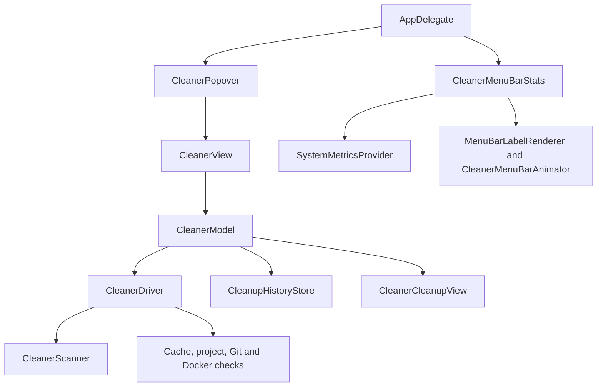

# xean architecture

xean is a native SwiftUI/AppKit menu bar app built with Swift Package Manager. Its executable target is
still named `BlitzClean`. The active app creates one status item and a native `NSPopover`; it does not
create the inherited dashboard, process controllers, pressure monitor, or Sparkle updater.

## Runtime flow

The diagram shows responsibilities; `CleanerModel` writes the cleanup ledger after a driver reports a
successful removal. UI state stays on the main actor. Native scans and deletion checks run through utility
tasks, with cancellation propagated to the scanner.

## App and presentation

All source paths below are relative to [`Sources/BlitzClean`](../Sources/BlitzClean).

| File / type | Role |
| --- | --- |
| `Entry.swift` | Entry point and inherited preference migration |
| `BlitzCleanApp.swift` / `AppDelegate` | Accessory app lifetime, status item, native menu, outside-click handling, and keyboard routing |
| `CleanerPopover.swift` | AppKit-owned material, border, arrow, shadow, placement, 180 ms fade, and compact Quit height |
| `CleanerView.swift` | Header and theme toggle, auto-clean/low-space inputs, category selection, stats settings, login switch, footer, and confirmations |
| `CleanerControls.swift` | Native `.glass` / `.glassProminent` on macOS 26+, bordered fallbacks, and aligned native switches |
| `CleanerCategoryRow.swift` | Category inventory and direct Delete; `CleanerDisclosureReveal` clips animated height without animating text |
| `CleanerCleanupView.swift` | Scanning, deletion queue, successful, empty, and partial outcomes |
| `CleanerScrollEffects.swift` | Edge blur/fade and accessibility adjustments |
| `CleanerScrollBehavior.swift` | 180 ms easing for mouse-wheel steps; native trackpad momentum |
| `CleanerSounds.swift` | Bundled WAV playback through AVAudioPlayer, one voice, 70% volume, active-app gating |
| `LaunchAtLoginController.swift` | `SMAppService.mainApp` registration and error reporting |

Popover content is 420 × 580 points, shortened for smaller screens. Quit uses 64 points of content height.
The header theme button persists `CleanerModel.darkTheme` separately from cleanup preferences. AppDelegate
observes this value and updates the existing popover's Aqua/Dark Aqua appearance, including native controls,
without replacing the hosted view or changing cleanup state. A temporary in-memory image of the old
rendered view fades away over 180 ms; it does not intercept input or expose duplicate accessibility content.
Reduce Motion disables the fade, and close/resize cancels it. The theme defaults to light.
On macOS 26+, `CleanerPopover` styles AppKit's backdrop `NSGlassEffectView` as regular frosted glass with a
neutral tint matching the theme. It skips the hosted content subtree, preserves full window/content opacity, and restores
the standard material for Reduce Transparency or increased contrast. It retains native material on
older macOS versions or if AppKit does not expose a glass backdrop.
`CleanerStatusAnchor` locates the trailing eraser. On opening, `CleanerPopover` captures that screen
rectangle in a transparent, noninteractive `CleanerPresentationAnchor` window and presents the native
popover relative to it. The host stays fixed while the menu bar relayouts, then disappears on close.
Reopening captures the eraser's current location. Dismissal clears transient state only after the window
closes; a generation check prevents a stale close completion from dismissing a reopened panel.

## State and operations

`CleanerModel` owns preferences, free disk space, category snapshots, busy state, individual failures,
background scheduling, the last persisted outcome, and the current `CleanerCleanup` presentation.
`CleanerDriver` separates native file operations from fixture-backed tests.

### Manual Clean

1. Capture the selected scope and create a unique cleanup presentation ID.
2. Reuse completed manual category scans at most 30 seconds old; scan missing or expired categories.
3. Consolidate candidates, deduplicating paths and excluding descendants of a selected worktree.
4. Revalidate and remove each candidate through the native driver.
5. Record each success, invalidate matching inventory paths, and publish its removed ID. The view collapses
   that row only after removal succeeds. Failed entries keep their reason.
6. Present the measured outcome after the final collapse. Empty and partial results have distinct states.

Closing the panel clears its presentation ID, not the underlying operation. Completion cannot restore an
old result into a newly opened panel. Individual Delete uses the same removal pipeline with a single
category, even if that category is unchecked for bulk cleanup; it uses brief footer feedback instead.

### Automatic cleanup

A task checks whether work is due every minute. The configured background interval is fixed at 25 minutes,
with the last check persisted across launches. Auto-clean requires explicit opt-in and a valid disk reading
below its own threshold. It always uses a fresh scan with automatic age rules, then checks free space again
before deletion. It does not open a progress or result screen. Warning badges use the independent warning
threshold and never invoke the notification framework.

## Scanning and removal services

| Component | Responsibility |
| --- | --- |
| `CleanerPolicy.swift` | Category catalog, supported cache roots, default project roots, normalized thresholds and age settings |
| `CleanerScan.swift` | `CleanerItem`, `CleanerKeptItem`, `CleanerScan`, `NativeCleanerDriver`, scanner, and project safety checks |
| `QuickClean.swift` / `CacheCleaner` | Allowlisted cache traversal, tree fingerprinting, identity/activity/age revalidation, and removal |
| `DeveloperArtifacts.swift` | Project, dependency, and build-output discovery |
| `DeveloperArtifactCleanup.swift` | Dependency and worktree validation and removal |
| `GitWorktrees.swift` | Local checkout identity, branch/merge status, dirty/ignored files, locks, and primary-checkout protection |
| `DockerStorage.swift` | Verified local Docker endpoint, inspection, and unused builder-cache pruning |
| `CleanupHistory.swift` | Volume measurements, recorded removals, file locking, and bounded atomic ledger writes |

Cleaner filesystem traversal has no arbitrary entry, depth, project-count, or elapsed-time cap. It uses
cancellable depth-first traversal and prunes generated directories during project discovery. This is not
an exhaustive search of every folder on every mounted disk. External commands retain hang timeouts.

Root symlinks are protected. Nested package links are fingerprinted and removed as links without walking
their destinations. Unreadable trees, special files, failed activity checks, and identity changes keep the
candidate. [The user guide](CLEANER.md#cleanup-rules) specifies manual versus automatic age policies.
A small race remains between final validation and filesystem removal; the implementation is not a security
boundary against a hostile process changing the same tree.

## Menu bar metrics

`CleanerMenuBarStats` owns the enabled state, metric selection, memory display format, and two-second timer.
It samples `SystemMetricsProvider` without starting `SystemMonitor`'s historical dashboard machinery.
`MenuBarLabelRenderer` retains the inherited icons and typography. `CleanerMenuBarAnimator` animates width
and visibility for 180 ms with the eraser at the trailing edge. Disabling stats cancels their timer and
clears their snapshot. The cleaner continues its independent disk-space checks.

## Compatibility names

| Identifier | Current value / contents |
| --- | --- |
| macOS display name, bundle name, and permission copy | `xean` |
| SwiftPM package, target, and executable | `BlitzClean` |
| Packaged app | `dist/BlitzClean.app` |
| Bundle / preference domain | `com.blitzreels.BlitzClean` |
| Local data directory | `~/Library/Application Support/BlitzClean` |
| `cleaner.preferences.v1` | Categories, auto/warning modes and thresholds, worktree age, preserved custom roots |
| `cleaner.lastCheck` | Background scheduling timestamp |
| `cleaner.lastOutcome` | Most recent cleanup count, measured bytes, kept count, and observed free-space gain |
| `cleaner.showMenuBarStats` and shared menu bar keys | Enabled metrics and memory format |
| `cleaner.darkTheme` | Native popover theme; false (light) by default, independent of cleanup preferences |
| `cleanup-history.json` | Up to 1,000 removal records; atomic writes and owner-only permissions |

These names preserve compatibility with inherited data. xean and an installed BlitzClean build can share
preferences and history; they are not isolated app identities yet. `BrandMigration` retains the older
`fr.algomax.FreeSpace` preference migration. `AppData` supplies paths and legacy file-migration helpers.
See [Privacy](PRIVACY.md) for what the active cleaner reads and stores.

## Dependencies and retained code

| Dependency | Use |
| --- | --- |
| SwiftUI, AppKit, Foundation, Combine | UI, lifecycle, state, and local filesystem work |
| ServiceManagement | Start at login |
| AVFoundation | Native playback of bundled Cuelume cues |
| Sparkle | Inherited SwiftPM framework; updater is not instantiated by xean |
| LiquidGlass | Pinned SwiftPM package used by retained shared views; the active cleaner uses native controls |
| Cuelume | Eight pre-rendered WAV assets; no JavaScript runtime in the app |

[`Package.swift`](../Package.swift) and `Package.resolved` define the actual dependency versions.
Older `BlitzDashboardView`, recovery, process-control, media, and storage-browser components remain for
upstream code compatibility and tests. Their presence does not make them xean features.

## Build and verification map

| Path | Purpose |
| --- | --- |
| [`start.sh`](../start.sh) | Build on first launch, open the local app, explicit `--build` for changes |
| [`scripts/build-app.sh`](../scripts/build-app.sh) | Release build, SDK linker stamp, resource/framework bundling, and code signing |
| [`scripts/check.sh`](../scripts/check.sh) | Build, serial tests, Swift formatting, plist validation, and shell syntax |
| [`Tests/BlitzCleanTests`](../Tests/BlitzCleanTests) | Cleaner policy/model, large trees, symlinks, inventory, menu bar, popover, sounds, and fixture renders, plus inherited suites |
| [`support`](../support) | Bundle metadata and entitlements |
| [`assets/brand`](../assets/brand) | Retained bundle artwork and icon sources |
| [`licenses`](../licenses) | Preserved third-party notices |

See [Contributing](../CONTRIBUTING.md) for focused checks, [Design](DESIGN.md) for UI rules, and
[Releasing](RELEASING.md) before distributing binaries.
